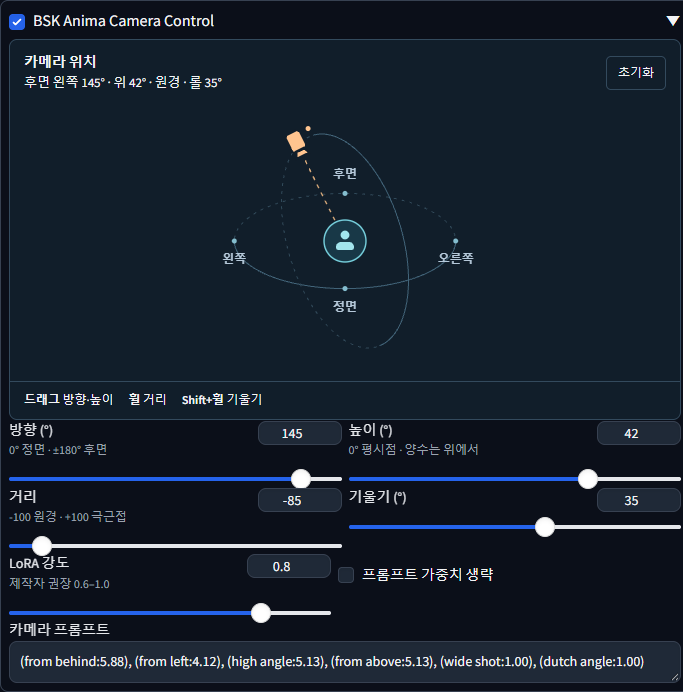
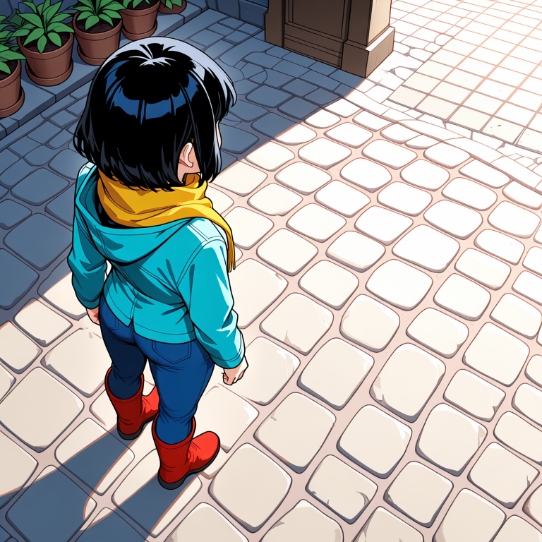

# BSK Anima Camera Control for Forge Neo

Forge Neo의 `txt2img`에서 Anima용 BSK Camera Control LoRA를 조작하는 확장입니다. 궤도 위 카메라 표식을 움직이면 방향·높이·거리·기울기가 바뀌고, 생성에 사용할 카메라 태그를 확인할 수 있습니다.

| Forge Neo 카메라 패널 | 같은 설정으로 생성한 예시 |
| --- | --- |
|  |  |

예시는 `NovaAnimeAMV70`, 시드 `482719`, LoRA 강도 `0.8`, 방향 `145°`, 높이 `42°`, 거리 `-85`, 롤 `35°`로 생성했습니다. PNG에 실제 생성 프롬프트와 설정이 들어 있습니다.

## 설치

### 준비

- Anima를 지원하는 Forge Neo와 Anima 체크포인트를 준비합니다. Forge Neo `neo-2.28`의 `NovaAnimeAMV70`, `qwen_3_06b_base.safetensors`, `qwen_image_vae.safetensors` 조합에서 확인했습니다.
- Git으로 설치하려면 이 비공개 저장소를 읽을 수 있는 GitHub 계정으로 인증합니다. ZIP으로 설치하려면 같은 계정으로 저장소를 엽니다.

### 확장 설치

PowerShell에서 아래 명령을 실행합니다. `E:\sd-webui-forge-neo`는 자신의 Forge Neo 설치 경로로 바꿉니다.

```powershell
cd 'E:\sd-webui-forge-neo\extensions'
git clone https://github.com/dsw1357/forge-neo-bsk-anima-camera-control.git forge-bsk-camera-control
```

ZIP으로 설치하려면 이 저장소의 **Code → Download ZIP**을 선택합니다. 압축을 풀고 폴더 이름을 `forge-bsk-camera-control`로 바꿔 `extensions` 아래에 둡니다. 확장 폴더 바로 아래에 `scripts`, `javascript`, `metadata.ini`가 보여야 합니다. 이미 같은 확장이 설치돼 있다면 기존 폴더를 백업한 뒤 교체합니다.

### LoRA 설치

1. 제작자 페이지에서 **v1.0**의 `anima_bsk-00000640_机位控制.safetensors`를 받습니다. [ModelScope 모델 파일](https://www.modelscope.cn/models/bskhuian/Anima_Camera_Position_Control), [Civitai v1.0](https://civitai.red/models/2814655/bskanimacamera-control?modelVersionId=3174431)
2. 파일을 `BSKAnimaCamera-v1.0.safetensors`로 이름을 바꿔 Forge Neo의 `models\Lora`에 놓습니다. 확장은 이 이름으로 가중치를 찾습니다.
3. Forge Neo를 다시 시작합니다. **Anima** 프리셋에서 체크포인트와 해당 VAE·텍스트 인코더를 선택합니다.

설치한 v1.0 파일을 확인할 때 사용할 SHA-256은 아래와 같습니다.

```text
6d1f0c002abf3f7108d53fddba75bfb1f4936b948a300f667afa455ea8aefd81
```

## 사용 방법

1. `txt2img`에서 **BSK Anima Camera Control**을 켜고 피사체와 장면 프롬프트를 입력합니다.
2. 궤도에서 카메라를 움직입니다. 파란 표식은 피사체, 주황색 표식은 카메라, 점선은 카메라가 바라보는 방향입니다.
3. **카메라 프롬프트** 미리보기를 확인하고 **Generate**를 누릅니다. 확장은 카메라 태그와 LoRA를 프롬프트에 자동으로 추가합니다. LoRA 강도 기본값은 `0.8`이고 원작자 권장 범위는 `0.6–1.0`입니다.

| 조작 | 동작 |
| --- | --- |
| 궤도에서 드래그 | 방향과 높이 |
| 마우스 휠 | 거리 |
| Shift+휠 | 기울기 |
| 궤도에 포커스를 둔 상태에서 화살표, `+` / `-`, `[` / `]` | 방향·높이, 거리, 기울기 |
| 슬라이더 또는 숫자 입력 | 개별 값 조절 |
| 초기화 | 카메라 위치를 기본값으로 복원 |

정면에서 시작하려면 방향 `0°`, 높이 `0°`를 사용합니다. 뒤에서 위쪽으로 내려다보려면 방향 `±180°`, 양수 높이값부터 조절합니다. 거리 음수는 원경, 양수는 근접입니다. 각도와 거리는 생성 모델에 전달하는 구도 지시이며, 이미지에서 그대로 재현되는 정도는 체크포인트와 프롬프트에 따라 달라집니다.

### 문제 해결

- **패널이 보이지 않을 때** Forge Neo를 다시 시작한 뒤 **Extensions → Installed**에서 확장이 활성화됐는지 확인합니다.
- **LoRA를 찾지 못할 때** `models\Lora\BSKAnimaCamera-v1.0.safetensors`의 경로와 파일 이름을 확인합니다. 파일을 실행 중에 추가했다면 LoRA 목록을 새로 고치거나 Forge Neo를 다시 시작합니다.
- **카메라 위치는 바뀌는데 구도가 약할 때** 시드를 고정한 상태에서 정면과 후면처럼 차이가 큰 설정을 비교합니다. 프롬프트에 이미 들어 있는 구도 태그도 함께 확인합니다.

## 원작자와 라이선스

- **원작자 灰暗x (bskhuian)** — BSK Anima Camera Control LoRA와 `ComfyUI-bsk_UI`의 카메라 태그 계산 로직을 제작했습니다. [ModelScope 원본 프로젝트](https://www.modelscope.cn/models/bskhuian/Anima_Camera_Position_Control), [제작자 카메라 제어 안내](https://www.bilibili.com/video/BV11SNq6wEvP)
- [`bsk_camera_tags.py`](bsk_camera_tags.py)는 원본 `ComfyUI-bsk_UI_26111101.zip`에 들어 있는 `nodes/camera_control_node.py`의 사본입니다. 원본 저작권 표시와 SPDX 라이선스 표기를 보존했습니다.
- Forge Neo 연동 코드와 궤도 UI는 이 저장소에서 제공하며, 확장 소스는 [AGPL-3.0-or-later](LICENSE)로 배포합니다. LoRA 파일은 위의 원작자 배포처에서 받을 수 있습니다.
